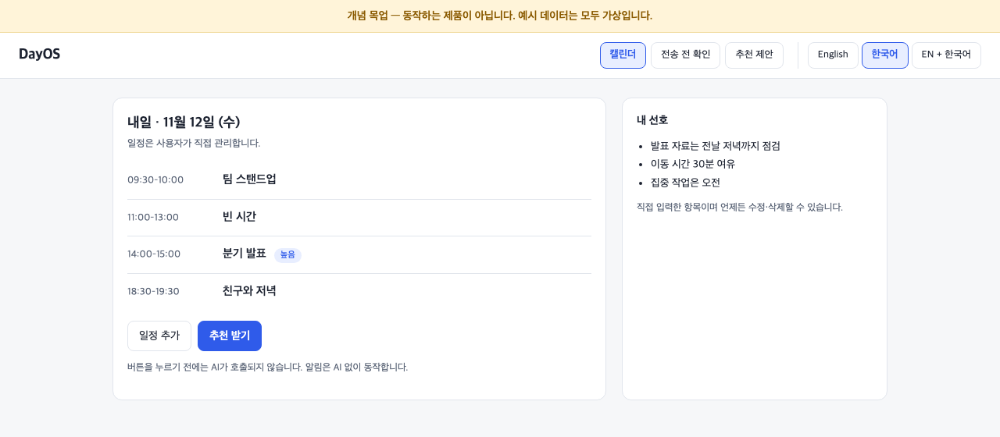
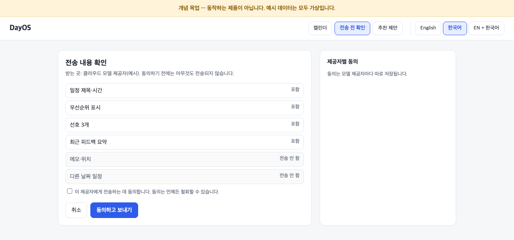
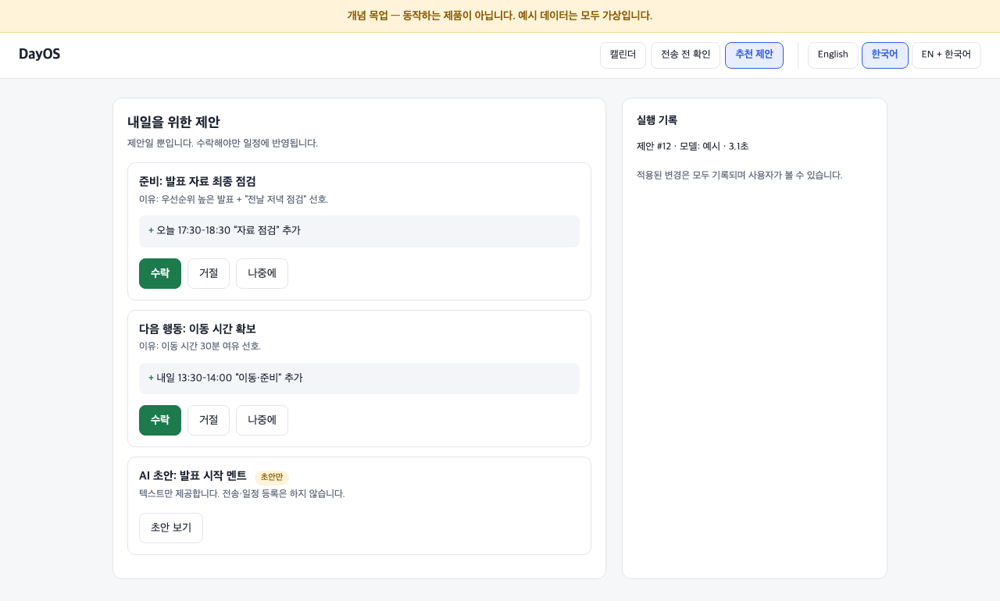
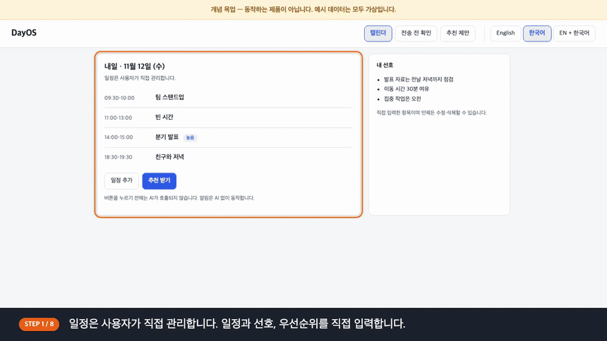

# DayOS

[English](README.md) | [한국어](README.ko.md)

**Context-Aware Personalized AI Planner (맥락 기반 개인화 AI 플래너)**

사용자가 직접 짠 일정과 개인 선호를 바탕으로, 요청했을 때 맞춤 준비 사항과 다음 행동을 제안하는 웹 기반 AI 플래너입니다.

> **상태:** 기획·설계 단계입니다. 앱 코드는 아직 없습니다. 아래 내용은 목표이며 구현된 기능이 아닙니다.

## 제품 비전

- **일정은 내가 직접.** 일정의 추가·수정은 사용자가 합니다.
- **개인화.** 일정, 선호, 우선순위, 이전 피드백을 바탕으로 추천합니다.
- **요청할 때만 AI.** 요청하지 않으면 추천은 나오지 않습니다. 알림은 AI 없이 규칙으로 동작합니다.
- **제안과 실행의 분리.** AI는 제안만 합니다. 사용자가 승인한 것만 적용되며, 적용된 변경은 모두 기록됩니다.
- **개인정보.** 사용자별 데이터 분리, 삭제 지원, 외부 모델에 보내기 전 동의.

## 상위 수준 구조

```text
브라우저 (웹앱)
   │
앱 서버 ── 인증 / 사용자별 데이터 분리
   ├─ 캘린더 서비스       사용자만 변경
   ├─ 알림 서비스         규칙 기반, AI 미사용
   └─ AI 추천             요청할 때만
         ├─ 동의 게이트   외부 호출 전 확인
         ├─ 제안 저장소   AI 출력은 여기에만 저장
         ├─ 실행 기록     승인된 변경과 결과
         └─ 모델 계층     모델 비종속 어댑터 (클라우드 / 로컬)
```

개념 수준의 도식입니다. 구현 상세, 개인화 내부 로직, 평가 데이터는 공개 문서에 포함하지 않습니다.

## 개념 UI 미리보기

> **개념 목업입니다. 동작하는 제품 화면이 아닙니다.** 예시 데이터는 모두 가상이며, 앱 코드는 아직 없습니다.

영어 / 한국어 전환이 되는 정적 HTML 한 장입니다: [`docs/concept/index.html`](docs/concept/index.html) (브라우저에서 열어 보세요).

| 화면 | 보여 주는 것 |
|---|---|
| 1. 캘린더 | 사용자가 관리하는 일정과 선호. 요청하기 전에는 AI 호출 없음 |
| 2. 전송 전 확인 | 모델에 보낼 정보를 미리 보여 주고 동의를 받음 |
| 3. 추천 제안 | 수락·거절할 수 있는 제안 카드와 실행 기록 |





### 사용 방법 영상

개념 목업을 자막과 함께 보여 주는 짧은 시연입니다(한국어 자막). 실제 제품을 화면 녹화한 것이 아니라 목업에서 생성한 영상입니다.



[MP4 내려받기 (한국어 자막)](docs/assets/dayos-concept-walkthrough.ko.mp4)

## 프로젝트 현황

| 영역 | 상태 |
|---|---|
| 제품 정의 | 초안 완료 |
| 구조 설계 | 초안 완료 |
| 개념 UI | 목업만 있음 |
| 앱 코드 | 시작 전 |

## 저작권 및 사용

Copyright © 2026 Sihun Wang. 모든 권리 보유.

이 프로젝트는 열람 및 포트폴리오 시연 목적으로 공개되어 있습니다.

원본 소스코드, 문서, 디자인, 프로젝트 고유 자산에 대한 모든 권리는 저작자에게 있습니다.

관련 법령 또는 GitHub 이용약관이 허용하는 범위를 제외하고, 저작자의 사전 서면 허락 없이 원본 자료를 복제, 수정, 재배포하거나 상업적으로 이용할 수 없습니다.

외부 라이브러리, 의존성 및 기타 외부에서 가져온 자료는 각각의 라이선스와 소유권을 따릅니다.

라이선스, 협업 또는 상업적 문의는 저장소 소유자에게 연락해 주세요.

> 이 한국어 번역은 참고용이며, 영어와 한국어가 다를 경우 [영어 원문](README.md#copyright--usage)을 기준으로 합니다.
