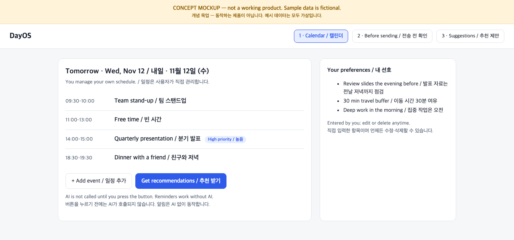
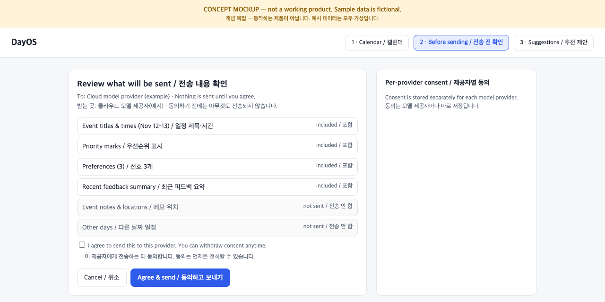
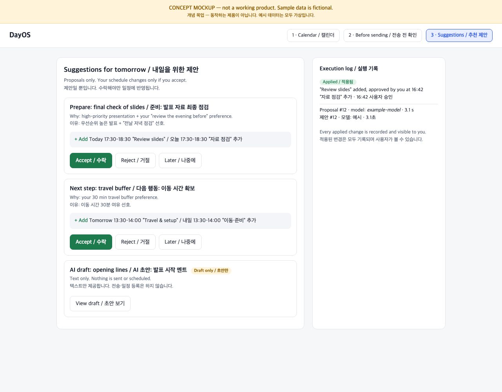

# DayOS

**Context-Aware Personalized AI Planner**
사용자가 직접 짠 일정과 개인 선호를 바탕으로, 요청했을 때 맞춤 준비 사항과 다음 행동을 제안하는 웹 기반 AI 플래너.
A web-based planner that, on request, turns your own schedule and preferences into personalized preparation and next-step suggestions.

> 상태 / Status: 기획·설계 단계. 앱 코드는 아직 없습니다. 아래 내용은 목표이며 구현된 기능이 아닙니다.
> Planning and design phase. No application code yet. Everything below describes goals, not shipped features.

## Product Vision

- **일정은 내가 직접.** 일정의 추가·수정은 사용자가 합니다. / You build your own schedule.
- **개인화.** 일정, 선호, 우선순위, 이전 피드백을 바탕으로 추천합니다. / Suggestions use your schedule, preferences, priorities, and past feedback.
- **요청할 때만 AI.** 요청하지 않으면 AI 추천은 나오지 않습니다. 알림은 AI 없이 규칙으로 동작합니다. / AI runs only when you ask.
- **제안과 실행의 분리.** AI는 제안만 합니다. 일정 변경 등 실행은 사용자가 승인한 것만, 결과 기록과 함께 적용됩니다. / The AI only proposes; only what you approve is applied and logged.
- **개인정보.** 사용자별 데이터 분리, 삭제 지원, 외부 AI에 보내기 전 동의. / Per-user data isolation, deletion, and consent before any data goes to an external model.

## High-level Architecture

```text
Browser (web app)
   │
App server ── auth / per-user data isolation
   ├─ Calendar service        user-only writes
   ├─ Reminder service        rule-based, no AI
   └─ AI recommendation       on request only
         ├─ Consent gate      before any external call
         ├─ Proposals         AI output is stored here only
         ├─ Execution log     approved changes and their results
         └─ Model layer       model-agnostic adapters (cloud / local)
```

Concept 수준의 도식입니다. 구현 상세, 개인화 내부 로직, 평가 데이터는 공개 문서에 포함하지 않습니다.

## Concept UI Preview / 개념 UI 미리보기

> **개념 목업입니다. 동작하는 제품 화면이 아닙니다.** 예시 데이터는 모두 가상이며, 앱 코드는 아직 없습니다.
> **These are concept mockups, not screenshots of a working product.** All data is fictional and no application code exists yet.

정적 HTML 한 장으로 만든 설명용 화면입니다. / A single static HTML page for illustration: [`docs/concept/index.html`](docs/concept/index.html)

| # | Screen / 화면 | What it shows / 보여 주는 것 |
|---|---|---|
| 1 | Calendar / 캘린더 | 사용자가 직접 관리하는 일정, 선호, "추천 받기" 버튼 (누르기 전에는 AI 호출 없음) / User-managed schedule and preferences; no AI call until requested |
| 2 | Before sending / 전송 전 확인 | 모델에 보낼 정보를 미리 보여 주고 동의를 받음 / Shows exactly what will be sent and asks for consent |
| 3 | Suggestions / 추천 제안 | 수락·거절 가능한 제안 카드와 실행 기록 / Proposal cards with accept/reject and an execution log |





## Project Status / 프로젝트 현황

| Area / 영역 | Status / 상태 |
|---|---|
| Product definition / 제품 정의 | 초안 완료 / Draft complete |
| Architecture / 구조 설계 | 초안 완료 / Draft complete |
| Concept UI / 개념 UI | 목업 / Mockup only |
| Application code / 앱 코드 | 없음 / Not started |

## 저작권 및 사용 / Copyright & Usage

### English

Copyright © 2026 Sihun Wang. All Rights Reserved.

This project is publicly available for viewing and portfolio demonstration purposes.

All rights to the original source code, documentation, designs, and project-specific assets are reserved by the author.

No permission is granted to reproduce, modify, redistribute, or commercially use the original materials without prior written authorization, except as permitted by applicable law or GitHub's Terms of Service.

Third-party libraries, dependencies, and other externally sourced materials remain subject to their respective licenses and ownership rights.

For licensing, collaboration, or commercial inquiries, please contact the repository owner.

### 한국어

Copyright © 2026 Sihun Wang. 모든 권리 보유.

이 프로젝트는 열람 및 포트폴리오 시연 목적으로 공개되어 있습니다.

원본 소스코드, 문서, 디자인, 프로젝트 고유 자산에 대한 모든 권리는 저작자에게 있습니다.

관련 법령 또는 GitHub 이용약관이 허용하는 범위를 제외하고, 저작자의 사전 서면 허락 없이 원본 자료를 복제, 수정, 재배포하거나 상업적으로 이용할 수 없습니다.

외부 라이브러리, 의존성 및 기타 외부에서 가져온 자료는 각각의 라이선스와 소유권을 따릅니다.

라이선스, 협업 또는 상업적 문의는 저장소 소유자에게 연락해 주세요.

> 영어와 한국어가 다를 경우 영어 원문을 기준으로 합니다. / If the two versions differ, the English text prevails.
