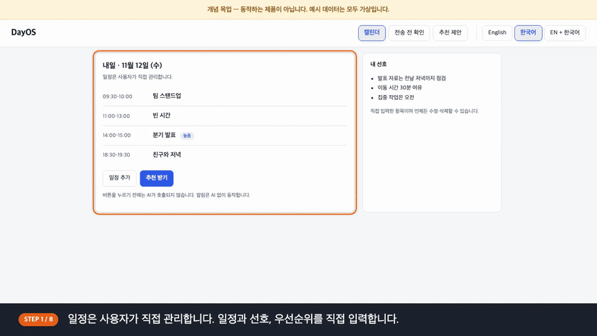
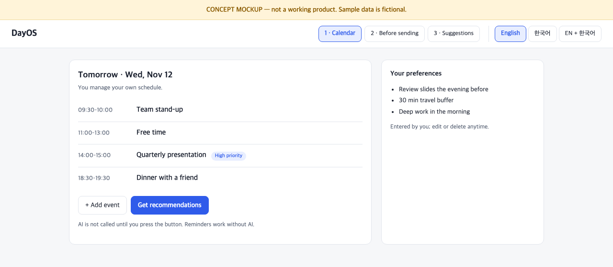
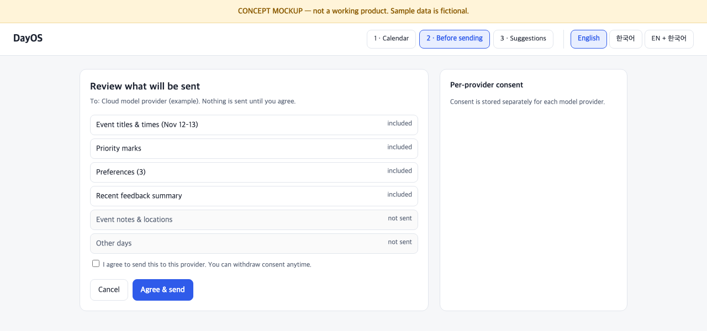
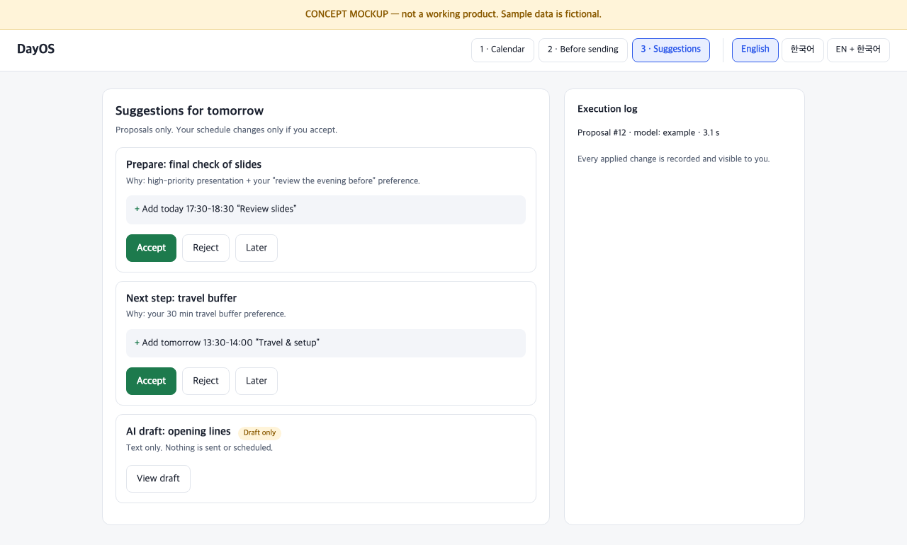

<h1 align="center">DayOS</h1>

<p align="center">
  <b>Context-Aware Personalized AI Planner</b><br>
  Your schedule, your preferences — AI suggestions only when you ask, applied only when you approve.
</p>

<p align="center">
  <a href="README.md">English</a> | <a href="README.ko.md">한국어</a>
</p>

<p align="center">
  
  
  
</p>

<p align="center">
  <br>
  <sub>Concept mockup walkthrough (Korean captions). Not a working product; all data is fictional.</sub>
</p>

> **Status:** Planning and design phase. No application code yet. Everything below describes goals, not shipped features.

## Contents

- [Product Vision](#product-vision)
- [Concept UI](#concept-ui)
- [High-level Architecture](#high-level-architecture)
- [Project Status](#project-status)
- [Copyright & Usage](#copyright--usage)

## Product Vision

- **You build your own schedule.** Events are created and edited by the user.
- **Personalized.** Suggestions use your schedule, preferences, priorities, and past feedback.
- **AI only when you ask.** Nothing is recommended unless you request it. Reminders run on plain rules, without AI.
- **Proposals are separate from actions.** The AI only proposes. Only what you approve is applied, and every applied change is logged.
- **Privacy.** Per-user data isolation, deletion support, and consent before any data goes to an external model.

## Concept UI

> **Concept mockups, not screenshots of a working product.** All data is fictional and no application code exists yet.

<table>
  <tr>
    <td align="center"><br><sub>1. Calendar</sub></td>
    <td align="center"><br><sub>2. Before sending</sub></td>
    <td align="center"><br><sub>3. Suggestions</sub></td>
  </tr>
</table>

- Try it: open [`docs/concept/index.html`](docs/concept/index.html) in a browser (English / Korean switch included).
- Video: [MP4, Korean captions](docs/assets/dayos-concept-walkthrough.ko.mp4). Generated from the mockup, not a screen recording of a real product.

## High-level Architecture

```text
Browser (web app)
   │
App server ── auth / per-user data isolation
   ├─ Calendar service        user-only writes
   ├─ Reminder service        rule-based, no AI
   └─ AI recommendation       on request only
         ├─ Consent gate      before any external call
         ├─ Proposals         AI output is stored here only
         ├─ Execution log     approved changes and their results
         └─ Model layer       model-agnostic adapters (cloud / local)
```

A concept-level diagram. Implementation details, internal personalization logic, and evaluation data are not part of the public documentation.

## Project Status

| Area | Status |
|---|---|
| Product definition | Draft complete |
| Architecture | Draft complete |
| Concept UI | Mockup only |
| Application code | Not started |

## Copyright & Usage

Copyright © 2026 Sihun Wang. All Rights Reserved.

This project is publicly available for viewing and portfolio demonstration purposes.

All rights to the original source code, documentation, designs, and project-specific assets are reserved by the author.

No permission is granted to reproduce, modify, redistribute, or commercially use the original materials without prior written authorization, except as permitted by applicable law or GitHub's Terms of Service.

Third-party libraries, dependencies, and other externally sourced materials remain subject to their respective licenses and ownership rights.

For licensing, collaboration, or commercial inquiries, please contact the repository owner.
